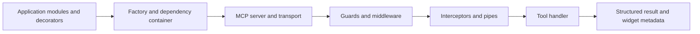

# NitroStack: architecture and code review

Reviewed on 15 October 2026, starting from revision
`f106a7504133891e403efb17c191e47d35ebc3e1`.

## What this repository contains

NitroStack is a TypeScript framework for building Model Context Protocol
servers. Its useful idea is to let an application declare tools, resources and
prompts in classes, while the framework takes care of registering them,
constructing their dependencies and exposing them through MCP transports.

This checkout contains three framework packages, scaffolding templates,
documentation and five sample applications. The upstream NitroStack branding,
Apache 2.0 licence and contributor notices are retained. This report describes
the code in this checkout; it does not imply that the fork authored the
upstream framework or that its sample integrations were deployed during review.

## How the packages fit together

| Package | Responsibility | Entry points worth reading |
|---|---|---|
| Core | Application registration, dependency injection, tools/resources/prompts, authentication, transport and tasks | [Application factory](../typescript/packages/core/src/core/app-decorator.ts), [server](../typescript/packages/core/src/core/server.ts), [tool execution](../typescript/packages/core/src/core/tool.ts) |
| CLI | Create projects, run development servers, generate components, build applications, upgrade and package projects | [Command registration](../typescript/packages/cli/src/index.ts), [build command](../typescript/packages/cli/src/commands/build.ts), [ZIP collection](../typescript/packages/cli/src/pack/zipper.ts) |
| Widgets | React hooks and helpers connecting a rendered widget with its MCP/OpenAI host | [Widget SDK](../typescript/packages/widgets/src/sdk.ts), [layout runtime](../typescript/packages/widgets/src/runtime/WidgetLayout.tsx), [tool-data component](../typescript/packages/widgets/src/withToolData.tsx) |

The implementation lives under `typescript/packages/`. The root repository
does not have an npm application to launch. NitroStudio is described in the
README as a separate desktop product; its desktop application source is not
part of these three packages.

### From an application class to an MCP request

An application declares modules, controllers and providers. Decorators store
metadata, which the application factory reads to register capabilities and
construct the server. The dependency container resolves registered values or
classes and caches instances. Explicit dependency metadata is available for
cases where emitted TypeScript metadata is not sufficient.

The inspected container is principally a singleton/value container. The
README's wider claim about scoped and transient lifecycles should not be read
as proof that every provider supports those lifetimes through this container.

For tool execution, guards run first, followed by middleware, interceptors,
pipes and the handler. Exception filters handle failures around that pipeline.
The server also manages input handling and MCP response formatting. A tool's
schema, annotations and widget metadata are converted into the structures
advertised to the client.



### Transports, authentication and background work

The source supports stdio and HTTP-related transports, including streamable
HTTP and compatibility paths. OAuth configuration can affect transport setup.
The transport implementation is a substantial part of the repository; it is
not just an Express route around a tool function.

Authentication helpers cover API keys, JWTs, OAuth metadata, PKCE and token
storage/validation. These are mechanisms an application must configure and
apply. Their presence alone does not make every sample endpoint authenticated.

The task manager records task states, supports cancellation and completion,
and expires retained tasks. Rate limiting also has periodic cleanup. These
housekeeping timers should run while the application is active without forcing
an otherwise idle process to remain alive.

### Widgets and the CLI

Widgets wrap host state, tool calls and display information through React
hooks and a browser-facing SDK. The layout/runtime bridges supported host
contexts. A browser host is still required to validate the complete widget
experience; unit tests do not substitute for every supported host.

The CLI contains project templates, generators, development/build commands
and project packaging. Its packer collects allowed files, prunes ignored
directories and resolves real paths to avoid following links outside the
project. The review did not change that containment policy.

## Sample applications

The samples demonstrate different uses of the framework. Their README claims
are application context, not independently verified operational results.

| Sample | What the inspected layout shows | Verification boundary |
|---|---|---|
| Hackathon / Omniscient | Security, incident and boardroom tool modules | Live infrastructure integrations and operational actions were not exercised |
| InvoiceX-Ray | Invoice/compliance tools with a database-backed provider | No database, live benchmark service or regulatory-validation exercise was run |
| Zerogravity | Intake, triage, matching, discovery, booking and reference modules; fixtures and CSV data | No clinical validation or external service workflow was performed |
| Concord | Infrastructure-governance application and widgets | Cloud changes, budgets and live deployment claims were not verified |
| Vitta | Lending/consent workflows, test configuration and widgets | No credit decision, real identity workflow or financial transaction was performed |

The sample business logic, fixtures and datasets remain unchanged. Their
dependency declarations were only adjusted to avoid the same incompatible
MCP Apps major version found during the framework install.

## Problems found and changes made

### Fresh installs could select incompatible dependencies

Core uses Zod 3. The previous `@modelcontextprotocol/ext-apps >=0.1.0` range
allowed npm to select version 2.0.3, whose peer requirement is Zod 4. That
produced an `ERESOLVE` failure before the packages could be built.

The declarations now constrain MCP Apps to `>=0.1.0 <2.0.0`. This keeps the
current Zod 3 schemas and avoids an untested schema migration. Matching root
entries in the sample lockfiles were updated; their existing resolved package
versions were preserved. The framework checks used MCP Apps 1.7.5.

### The contributor setup did not install package dependencies

The TypeScript root is a coordinator package, with separate package manifests
and no configured npm workspaces. Installing only at that root did not install
the three packages' runtime dependencies. A workspace-based trial encountered
Windows link restrictions and was not retained.

`npm run install:all` now explicitly installs each package. `npm run test:all`
runs all three package suites, while the existing `npm test` still means core
tests. The contributor guide now distinguishes these commands and removes
references to undefined root `dev`, `lint` and `format` scripts.

### Windows build and test commands were broken

The package test scripts previously used POSIX-style environment assignment.
They now invoke Node with `--experimental-vm-modules` directly. The CLI build
uses Node's filesystem API to set executable permissions on Unix-like systems
and skips that step on Windows. It no longer depends on an external `chmod`
command.

### Housekeeping could prevent process exit

The rate-limit module created a referenced interval on import. The task
manager also created a referenced expiration interval. Both are now
unreferenced, so importing the module or creating an idle manager does not keep
Node alive by itself. Cleanup frequency, task transitions, rate-limit decisions
and the task manager's existing explicit destruction method are unchanged.

A new child-process smoke check imports the rate limiter, creates a task
manager and requires the process to exit normally within five seconds. This
checks the actual shutdown behavior rather than inspecting the timer code.

### Some documentation and tests no longer matched the implementation

The root README example omitted imports, a service implementation and useful
module/controller registration. It was replaced with a complete calculator
example using the existing public API.

The CLI branding test still referred to removed accent names. It now checks
the current signal/sky names without changing the runtime palette. The ZIP
link test now requests directory junctions on Windows and directory symlinks
elsewhere, preserving its escape/cycle assertions.

Generated dependencies, build output, coverage and TypeScript build metadata
are now ignored so local verification does not accidentally enter a commit.

## Verification

Checks ran on Windows with Node 20.18.1 and npm 10.8.2.

| Check | Result |
|---|---|
| Core TypeScript build | Passed |
| Widgets TypeScript build | Passed |
| CLI TypeScript build | Passed |
| Widget tests | 9 suites, 74 tests passed |
| Core tests | 50 suites, 577 tests passed; rerun completed and exited normally |
| CLI tests | 75 passed; one link-creation test blocked by Windows permissions |
| Housekeeping import/exit smoke check | Passed |
| Built CLI `--help` | Passed |
| README calculator example compiled against local SDK | Passed |

The Windows environment denied Node's native real-path resolver even for the
test-cache directory. Tests therefore used a temporary, uncommitted preload
that falls back to Node's portable resolver when the native call returns
`EPERM`. Filesystem permissions remain enforced. No source assertion was
disabled to make these checks pass.

The remaining CLI failure occurs during link creation, before the containment
assertions run. That test still needs execution in an environment that permits
directory links. It must not be reported as a successful traversal-security
test here. The other ZIP collection/archive checks passed with the filesystem
compatibility preload.

The reviewed package builds and unit tests are meaningful evidence for this
change, but they do not prove every sample application, host, OAuth provider or
production deployment works. No live external integration or package release
was performed.

## Running the checks again

From the repository root:

```bash
cd typescript
npm run install:all
npm run build
npm run test:all
npm run test:smoke --prefix packages/core
```

Each package can also be installed and tested independently. See
[CONTRIBUTING.md](../CONTRIBUTING.md). The test-only path-resolver preload used
in this environment is not a requirement added to the project.

## Overall assessment

The framework has a substantial implementation and an existing unit-test
suite. The most immediate problems found here were dependency compatibility,
Windows tooling, process lifetime and inaccurate setup/example instructions.
The fixes stay within those areas and retain the public application behavior.

Before relying on a particular sample in production, validate its actual
configuration, credentials, integrations and business rules in its intended
environment. For the framework itself, the next useful step is a clean Linux
and Windows CI run that includes the directory-link packaging test and
scaffolded applications against a real MCP client.
